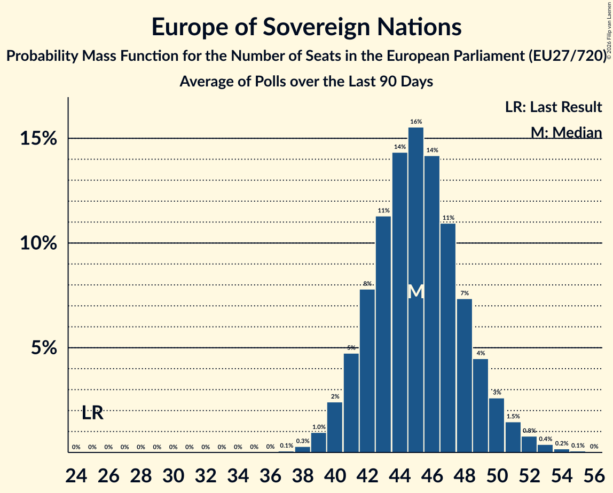

# Europe of Sovereign Nations

Members registered from **11 countries**:

> BG, CZ, DE, FR, HU, IT, LT, NL, PL, SI, SK

## Seats

Last result: **25** seats (General Election of 26 May 2019)

Current median: **46** seats (+21 seats)

At least one member in **7 countries** have a median of 1 seat or more:

> CZ, DE, HU, IT, NL, PL, SK

### Confidence Intervals

| Party | Area | Last Result | Median | 80% Confidence Interval | 90% Confidence Interval | 95% Confidence Interval | 99% Confidence Interval |
|:-----:|:----:|:-----------:|:------:|:-----------------------:|:-----------------------:|:-----------------------:|:-----------------------:|
| Europe of Sovereign Nations | EU | 25 | 46 | 42–50 | 41–51 | 40–52 | 39–55 |
| Alternative für Deutschland | DE | | 27 | 24–28 | 23–29 | 23–30 | 22–31 |
| Futuro Nazionale | IT | | 6 | 5–7 | 5–8 | 4–8 | 4–9 |
| Nowa Nadzieja | PL | | 4 | 4–5 | 3–6 | 3–6 | 3–6 |
| Forum voor Democratie | NL | | 3 | 2–4 | 2–4 | 2–4 | 2–4 |
| Mi Hazánk Mozgalom | HU | | 2 | 1–2 | 1–2 | 1–2 | 1–3 |
| REPUBLIKA | SK | | 2 | 2–3 | 2–3 | 2–3 | 1–3 |
| Svoboda a přímá demokracie | CZ | | 2 | 1–2 | 1–2 | 0–2 | 0–3 |
| Reconquête | FR | | 0 | 0–4 | 0–5 | 0–5 | 0–5 |
| Resni.ca | SI | | 0 | 0 | 0 | 0 | 0 |
| Tautos ir teisingumo sąjunga (centristai, tautininkai) | LT | | 0 | 0 | 0 | 0 | 0 |
| Trikolóra hnutí občanů | CZ | | 0 | 0 | 0 | 0 | 0 |
| Възраждане | BG | | 0 | 0–1 | 0–1 | 0–1 | 0–2 |

### Probability Mass Function

The following table shows the probability mass function per seat for the [poll average](average-2026-11-30.html) for Europe of Sovereign Nations.

| Number of Seats | Probability | Accumulated | Special Marks |
|:---------------:|:-----------:|:-----------:|:-------------:|
| 25 | 0% | 100% | Last Result |
| 26 | 0% | 100% |  |
| 27 | 0% | 100% |  |
| 28 | 0% | 100% |  |
| 29 | 0% | 100% |  |
| 30 | 0% | 100% |  |
| 31 | 0% | 100% |  |
| 32 | 0% | 100% |  |
| 33 | 0% | 100% |  |
| 34 | 0% | 100% |  |
| 35 | 0% | 100% |  |
| 36 | 0% | 100% |  |
| 37 | 0% | 100% |  |
| 38 | 0.2% | 99.9% |  |
| 39 | 0.6% | 99.8% |  |
| 40 | 2% | 99.1% |  |
| 41 | 3% | 97% |  |
| 42 | 6% | 94% |  |
| 43 | 9% | 88% |  |
| 44 | 12% | 80% |  |
| 45 | 14% | 68% |  |
| 46 | 14% | 55% | Median |
| 47 | 12% | 40% |  |
| 48 | 10% | 28% |  |
| 49 | 7% | 19% |  |
| 50 | 5% | 12% |  |
| 51 | 3% | 7% |  |
| 52 | 2% | 4% |  |
| 53 | 1.2% | 2% |  |
| 54 | 0.6% | 1.2% |  |
| 55 | 0.3% | 0.5% |  |
| 56 | 0.1% | 0.2% |  |
| 57 | 0.1% | 0.1% |  |
| 58 | 0% | 0% |  |

